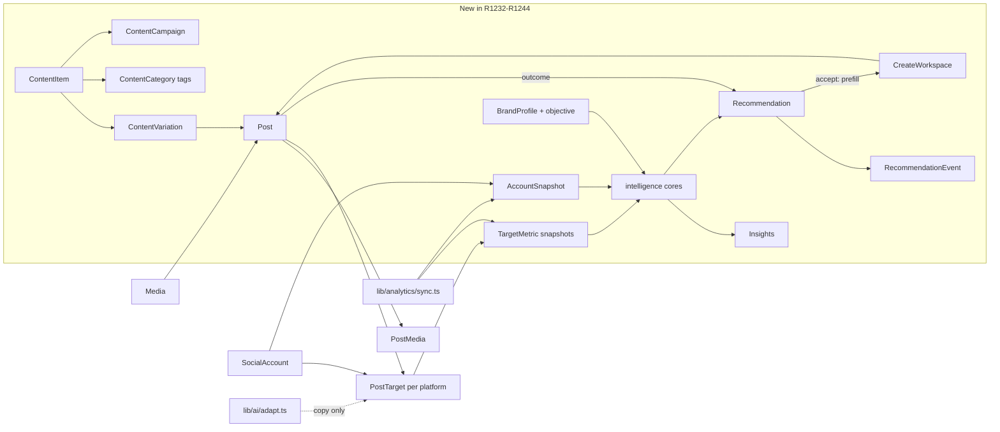

# Content Intelligence: architecture audit and phased plan (R1231)

Status: audit only, no code changed. Scope: the "Content Growth Engine" spec (Outlly Intelligence, Adapt lineage, Growth Planner, Content Memory). House style follows docs/features-1088-1091.md. Paths are relative to `outly-main-audit/outly-next15`. Line numbers were read in this round; "unverified" marks anything not confirmed in code.

## 1. Summary

1. Outlly already publishes one Post to many PostTargets and stores incremental TargetMetric snapshots (`prisma/schema.prisma:322`, `:379`, `:428`), so the metric half of the lineage exists.
2. Per-post numbers exist for three platforms only: Instagram, YouTube, Facebook (`lib/insights/post.ts:22`, `lib/analytics/sync.ts:25`). TikTok, X, LinkedIn, Threads have none.
3. Honesty rules (unavailable is never 0, no cross-platform sums, minimum samples) are coded in `lib/analytics/core.ts`, `lib/analytics/trend.ts`, `lib/live/suggest.ts`. The new engine imports them, not restates them.
4. The deterministic-rules-then-AI-words pattern exists in Profile Review (`lib/live/review-core.ts` + `review.ts`) and is the template for insights.
5. Adapt (`lib/ai/adapt.ts`, `adapt-core.ts`) generates per-platform copy but keeps no identity. CORRECTION to CONTEXT.md: `adaptedFrom` appears only in a schema comment (`prisma/schema.prisma:327`, same in `schema.template.prisma`); no TypeScript file reads or writes it. The client keeps its own StoryMeta (`components/create/CreateWorkspace.tsx:144`, `startMeta`/`serializeMeta`), validated only as a string up to 20,000 chars (`lib/validation.ts:58`, `:89`). Backfill must parse it defensively.
6. Missing entities: ContentItem, ContentVariation, ContentCategory and tags, BrandProfile with objective, Recommendation, RecommendationEvent, ContentCampaign.
7. Missing engines: format-aware comparison, objective-weighted scoring, classification, topic aggregation, recommendation generator, outcome measurement.
8. Missing UI: no Content Intelligence route. Studio routes live under `app/(studio)/` (accounts, analytics, approvals, calendar, content, create, home, inbox, profile-review, settings, ...). Prefill must reuse `components/create/CreateWorkspace.tsx`, no second editor.
9. Missing jobs: only three Vercel crons (`vercel.json`: weekly-report Mon 03:30, retention 06:30, blog 01:00) plus the sweep pinger (`app/api/cron/sweep/route.ts`). Intelligence rides the existing sweep, no new cron per phase (Hobby CPU is tight).
10. Impossible metrics, never promised: link clicks, conversions, leads, sales, and any post metric on TikTok/X/LinkedIn/Threads. See sections 5 and 8.

## 2. Current architecture map

### 2.1 Data models (`prisma/schema.prisma`)

| Model | Line | Role for this spec |
|---|---|---|
| User | 15 | workspace owner; `timezone` (:23), `postingGoal` (:39), `handle` (:66), `bio` (:67), `niche` (:68) are the only brand-like fields |
| SocialAccount | 170 | one connected account; `Plan.brandLimit` (:522) counts accounts per platform, there is no Brand entity |
| Post | 322 | content as published: `format` video/photo/carousel/story, `story`, `storyMeta` (:327), `hook`, `archivedAt`, `clientKey` |
| PostMedia | 365 | ordered slides for photo/carousel/story; video uses `Post.mediaId` |
| PostTarget | 379 | one per (post, platform), `@@unique([postId, platform])`; `platformPostId/Url`, `metricsCheckedAt`, `verifyState`, `removedAt`, `practice` |
| TargetMetric | 428 | increment snapshots per target: views, likes, comments, shares, saves; `@@index([targetId, capturedAt])` |
| AccountSnapshot | 1580 | daily followers/posts/views per account, `viewsScope` 28_days / recent_posts / lifetime; unique (accountId, day) |
| AccountSyncState | 1598 | last sync, error code, `cooldownUntil` (rate-limit awareness) |
| Idea | 1070 | free text, `source` manual / comment / suggestion, `doneAt`; no format, platform or evidence |
| Campaign, CampaignEvent | 1450, 1474 | billing OFFER campaigns; must not be reused. Content campaigns need another name |
| TeamMember | 953 | `ownerId`, `userId`, role editor/manager, `accountIds` JSON; the only agency-like structure |
| ReviewRequest | 445 | approval by link; `Post.requireApproval` gates publishing |
| BehaviorAnalysis, PerfSample | 909, 927 | admin/perf telemetry, unrelated |

Not present (`rg "^model (Brand|Content|Recommend)" prisma/schema.prisma` returned nothing): Brand, ContentItem, Recommendation.

### 2.2 Analytics and intelligence modules

- `lib/analytics/core.ts`: `STORED_METRICS` (:13), `STORED_BY_PLATFORM` (:20), `kpiMetrics` (:42, refuses to sum metrics a platform lacks), `engagementPct` (:55), `changePct` (:61), `dayKey` (:69), `resolveRange` (:87).
- `lib/analytics/trend.ts`: `trend`, `fairPrevious` (:58), `BEST_DAY_MIN` (:84), `bestWeekday` (:92), `LEAD_MIN` (:122), `leadPlatform` (:125). Pattern to copy: named threshold constants.
- `lib/analytics/sync.ts`: `SYNCABLE` (:25), staleness constants (:27-50: 6 h normal, 30 min for 48 h after publish, 6 targets per account, 24 per run, 10 accounts per run, 30 min cooldown).
- `lib/insights/post-core.ts`: `MetricKey` (:3), `TargetInsights` with unavailable[]/supported[] (:5), `engagementRate` (:30). `lib/insights/post.ts`: `CAN` per platform (:25), `targetInsights` (:184), `snapshotTarget` (:238), `postInsights` (:259).
- `lib/live/suggest.ts`: `suggest(input): Suggestion[]` (:45), pure rules with minimum samples, `median` (:21). `lib/live/review-core.ts` + `review.ts`: pillars, `combine` (:193), `gradeFor` (:183); the model only words the result.
- `lib/reports/weekly.ts` (`weeklyStats` :34, `sendWeeklyReports` :73), `weekly-core.ts`, `client-report*.ts`: weekly recap and client reports. `lib/retention/alerts.ts` (`sweepSpikes` :23).
- `lib/schedule/best-time*.ts`, `lib/dashboard/pulse*.ts`: best time and home pulse. `lib/analytics.ts` `getAnalytics` (60 s cache per CONTEXT.md; not re-read).
- `lib/pip/tools-analytics.ts`, `analytics-core.ts`, `compare-core.ts`: assistant tools over the same data.

### 2.3 Publishing lineage today

Media -> Post (+PostMedia) -> PostTarget per platform -> TargetMetric snapshots. `adaptCaptions` (`lib/ai/adapt.ts:122`) returns copy only, which the composer writes into PostTarget title/caption/hashtags. Nothing records that two Posts descend from one idea; any pointer lives in opaque `storyMeta` JSON.

### 2.4 Workspaces, teams, scope

- Workspace = owner User id. Members act inside the owner's workspace through TeamMember (:953).
- `lib/profiles.ts`: `listProfiles` (:32), `postFilter` (:67), `requestScope` (:80), `assertPostScope` (:93), `analyticsScope` (:162). Every intelligence query must start from `analyticsScope`/`postFilter`, never a bare `userId`.
- "Agency clients" today are separate owner workspaces a member is seated in, plus per-account scoping via `accountIds`. No Client entity. BrandProfile keys on (ownerId, scopeKey), see decision 3.
- Roles (`lib/team/roles.ts`): editor (drafts, needs approval) / manager (publish). Accept of a recommendation is editor-level; report export manager-level.

### 2.5 Jobs and crons

`vercel.json` lists three crons. `app/api/cron/` holds blog, health, retention, storage-copy, sweep, weekly-report. Metric sync is driven by the sweep and per-user triggers in `lib/analytics/sync.ts` with rate-limit state in AccountSyncState. A new job must hook into the sweep, be idempotent by a unique key, and read stored rows only (the engine never calls a platform API).

### 2.6 AI usage

Gemini via `lib/ai/llm.ts`/`llm-core.ts` with Kimi fallback (repo convention). Adapt has an offline fallback (`adapt-core.ts`). Gates in `lib/ai/entitlements.ts`, `lib/ai/features.ts`. Insight wording follows `review.ts`: engine output is the source of truth, the model only rephrases, and a validator (like `mergeAi`; not re-read) rejects wording that changes numbers.

### 2.7 Diagram



## 3. Reuse table

| Spec requirement | Existing module | Decision | Reason |
|---|---|---|---|
| Honest metrics (unavailable vs 0) | `lib/analytics/core.ts`, `lib/insights/post-core.ts` (`CAN`, unavailable[]) | Reuse, extend with `unsupported` | Existing code has two states; spec needs a third |
| Minimum samples, thresholds | `trend.ts` constants, `suggest.ts` | Reuse pattern, new constants | Different unit (posts per format, not days) |
| Per-post metrics | `TargetMetric`, `snapshotTarget`, `sync.ts` | Reuse as-is | Incremental and rate-limit aware |
| Post total from increments | sum of TargetMetric rows | Extend | One helper `targetTotals` so all readers share one definition |
| Account trend | `AccountSnapshot`, `fairPrevious` | Reuse as-is | Feeds Growth Overview |
| Rules + AI wording | `review-core.ts`/`review.ts` | Reuse pattern | Same contract |
| Suggestions | `lib/live/suggest.ts` | Extend, not replace | Live page keeps working; planner type can wrap `Suggestion` |
| Adapt copy per platform | `lib/ai/adapt.ts` | Extend | Optional variation write; generation unchanged |
| Format rules | `lib/formats.ts` `supportsFormat` (:40) | Reuse as-is | Source of the `unsupported` state |
| Weekly report | `lib/reports/weekly*.ts`, `client-report*.ts` | Extend | Add an intelligence block, same email and cron |
| Best time | `lib/schedule/best-time*.ts` | Reuse as-is | Recommendation "when" field |
| Ideas | `Idea`, `app/api/ideas` | Extend | "Save" on a recommendation creates an Idea; tables stay separate |
| Brand profile | `User.niche/bio/handle/timezone` | Replace for intelligence | Too thin; User fields stay for the public profile |
| Campaigns | `Campaign` (billing) | Do not reuse | Different meaning; new ContentCampaign |
| Approvals | `requireApproval`, ReviewRequest | Reuse as-is | Accepted recommendation becomes a normal draft |
| Scope and tenancy | `lib/profiles.ts`, `lib/team/roles.ts` | Reuse as-is | Mandatory entry point |
| Assistant | `lib/pip/tools*.ts` | Extend later | Read-only tools over stored insights |
| Dashboard | `app/(studio)/analytics/[platform]` | New route beside it | Cross-platform view does not fit a per-platform route |

## 4. Gaps

**Entities:** ContentItem, ContentVariation, ContentCategory (+ ContentItemCategory), BrandProfile (objective, audience, pillars, tone, avoid), ContentCampaign, Recommendation, RecommendationEvent.

**Engines (pure `*-core.ts`):** format-aware cohort builder, objective-weighted scoring, outlier classification (working, average, needs attention, insufficient data), topic aggregation, platform comparison without summing unlike metrics, recommendation generator, outcome evaluator, confidence from sample size and variance.

**UI:** Content Intelligence page with the 9 sections; brand profile editor; recommendation card (accept/edit/reject/save/done/feedback); category tagging in the Content library; empty and low-data states for every section.

**Jobs:** classification refresh after each sync batch; weekly intelligence report (extend `weekly-report`); outcome evaluation 7 and 28 days after "done"; bounded backfill worker.

**Cross-cutting:** RecommendationEvent audit trail, idempotency keys, plan gating (decision 7).

## 5. External API limitations

Scopes as read from code this round:

- Instagram: `instagram_business_basic`, `_content_publish`, `_manage_comments`; DM scope and `instagram_business_manage_insights` are optional (`lib/social/instagram.ts:17-23`). Per-post insights need the optional scope.
- Facebook: `pages_show_list, pages_read_engagement, pages_manage_posts, publish_video, read_insights` plus DM scopes (`lib/social/facebook.ts:9-13`).
- YouTube: `YT_SCOPES` (`lib/social/youtube.ts:35`); CONTEXT.md says yt-analytics.readonly is held. The constant's value was not read: unverified.
- TikTok: `user.info.basic,user.info.profile,video.publish,video.upload` (`lib/social/tiktok.ts:21`). No `video.list`, so no per-post numbers.
- X: `tweet.read tweet.write users.read media.write offline.access` (`lib/social/x.ts:25`). No metrics fetch is implemented; X API tiers also gate it. Treat as unavailable.
- LinkedIn: `openid profile email w_member_social` (`lib/social/linkedin.ts:26`). No analytics scope.
- Threads: `threads_basic, threads_content_publish, threads_read_replies, threads_manage_replies, threads_delet...` (`lib/social/threads.ts:14`, output truncated when read). An insights scope was not seen: unverified, assume absent.

| Platform | Per-post metrics | Per-account | Not obtainable |
|---|---|---|---|
| Instagram | views, reach, likes, comments, shares, saves, engagement rate, avg watch (`CAN`, `post.ts:25`) | followers, 28-day views (AccountSnapshot); windows max 30 days | link clicks, conversions; photo/story subsets unverified |
| YouTube | views, likes, comments, shares, avg watch, watch minutes | followers, views | saves, reach |
| Facebook | views, reach, likes, comments, avg watch, watch minutes | followers, views | shares and saves (not in `CAN`) |
| TikTok | none | profile only | all per-post |
| X | none (not implemented) | profile only | all per-post |
| LinkedIn | none | none | all |
| Threads | none | basic profile | all per-post |

Impossible on every held platform: link clicks, conversions, leads, sales, revenue. Saves exist only on Instagram.

### Honest UI consequence: three states

| State | Meaning | Example | Render |
|---|---|---|---|
| zero | platform reports it and it is 0 | Instagram post with 0 saves | "0" |
| unavailable | platform could give it, we cannot read it with held scopes | any TikTok post metric | "Not reported by TikTok", reason shown; excluded from means, ranks, totals |
| unsupported | the format or platform cannot have it | saves on YouTube, avg watch on a photo | "Not applicable"; never shown as a gap |

Rules: (1) a cohort needs a minimum number of posts with the metric reported (proposed 5 per format-platform cell, decision 6), else "not enough data"; (2) unavailable and unsupported never enter a mean, rank or total; (3) objectives needing impossible metrics (traffic, leads, sales) show "Outlly cannot measure clicks or sales; rankings use engagement as a proxy" or accept founder-entered outcomes (decision 1); (4) every insight shows confidence, posts analyzed, period.

Data risk: `TargetMetric.saves` defaults to 0 (`prisma/schema.prisma`, TargetMetric block) so a stored 0 on non-Instagram rows cannot tell zero from unavailable. The engine derives availability from `CAN` / `STORED_BY_PLATFORM` per platform, never from the stored value.

## 6. Proposed data model additions

Edit `prisma/schema.prisma` and `prisma/schema.template.prisma` identically. Ids are cuid, every table is owner-scoped.

```prisma
// R1233 sketch, not final
model ContentItem {
  id          String   @id @default(cuid())
  ownerId     String   // workspace (User.id), tenant key
  title       String?
  concept     String?  // one-line idea
  format      String   // primary format: video|photo|carousel|story
  origin      String   @default("manual") // manual|adapt|recommendation|backfill
  campaignId  String?
  archivedAt  DateTime?
  createdAt   DateTime @default(now())
  variations  ContentVariation[]
  categories  ContentItemCategory[]
  @@index([ownerId, createdAt])
}

model ContentVariation {
  id                String  @id @default(cuid())
  itemId            String
  postId            String  @unique // one Post is at most one variation
  parentVariationId String? // adapted from which variation
  kind              String  @default("original") // original|adapted
  tone              String? // AdaptTone used
  item ContentItem @relation(fields: [itemId], references: [id], onDelete: Cascade)
  post Post        @relation(fields: [postId], references: [id], onDelete: Cascade)
  @@index([itemId])
}

model ContentCategory {
  id      String @id @default(cuid())
  ownerId String
  name    String
  source  String @default("user") // user|suggested
  items   ContentItemCategory[]
  @@unique([ownerId, name])
}
model ContentItemCategory { itemId String; categoryId String; @@id([itemId, categoryId]) }

model BrandProfile {
  id        String @id @default(cuid())
  ownerId   String
  scopeKey  String @default("") // "" = whole workspace; else a client/account-group key
  objective String // awareness|engagement|community|traffic|leads|sales
  audience  String?
  pillars   String? // JSON string[]
  tone      String?
  avoid     String? // JSON string[]
  updatedAt DateTime @updatedAt
  @@unique([ownerId, scopeKey])
}

model Recommendation {
  id            String @id @default(cuid())
  ownerId       String
  scopeKey      String @default("")
  dedupeKey     String // hash(rule, format, platform, topic, period): idempotent regeneration
  title         String
  format        String?
  platform      String?
  concept       String
  why           String
  evidence      String // JSON: numbers the engine computed
  postsAnalyzed Int
  periodFrom    String
  periodTo      String
  confidence    String // low|medium|high
  nextAction    String
  status        String @default("open") // open|accepted|rejected|saved|done|expired
  wordedBy      String @default("rules") // rules|ai
  contentItemId String?
  createdAt     DateTime @default(now())
  @@unique([ownerId, scopeKey, dedupeKey])
}

model RecommendationEvent {
  id String @id @default(cuid()); recommendationId String; actorId String?
  type String // generated|accepted|edited|rejected|saved|done|feedback|outcome
  data String? // small JSON
  at   DateTime @default(now())
  @@index([recommendationId, at])
}

model ContentCampaign {
  id String @id @default(cuid()); ownerId String; name String; goal String?
  startsAt DateTime?; endsAt DateTime?; archivedAt DateTime?
  @@index([ownerId])
}
```

**Post link:** no new column on Post (hot table with many writers). `ContentVariation.postId` is unique and cascades from Post; readers join Post -> ContentVariation -> ContentItem. A ContentItem with no variations left is archived, not deleted. (The sketch needs a `variation ContentVariation?` back-relation on Post; that is a relation-only edit, no column.)

**Backfill:**
1. Every non-practice Post with a published target and no variation gets its own ContentItem (origin backfill, format = `Post.format`, concept = `firstSentence` of `story`, `lib/ai/adapt-core.ts:114`).
2. If `storyMeta` parses as JSON with a string `adaptedFrom` equal to another Post id of the same owner, attach as a variation of that item; otherwise ignore. The field shape is unverified (only a schema comment names it).
3. Never invent categories; leave empty, suggest later.
4. Batches of 200, resumable cursor, idempotent through unique `postId`.
5. From R1234, new posts create ContentItem and variation in the same transaction as post creation.

## 7. Phased plan

Rules for every round: schema edits in both prisma files; pure core with unit tests first; the engine never calls platform APIs; CRLF-aware edits for existing files; the lead pushes.

### R1231 Audit
- Files: this document. Tests: none. Risks: none. Deferred: everything below.

### R1232 Engine core (done with this audit)
- Files: `lib/intelligence/core.ts` (pure, no I/O): objectives and their metric priorities (traffic, leads and sales flagged as proxies because no platform gives clicks or conversions), `availabilityOf` (unsupported before unavailable before zero, derived from `supportsFormat` and the per-post metric support of `lib/insights/post.ts`), format cohorts with `MIN_SAMPLE = 3` and medians (never ranked across platform+format), topic lifts against each post's own cohort median, `confidenceOf` (low under 5, medium under 12, high from 12), what-is-working / needs-attention signals against the previous equal period (gated by `trend()`), recommendation drafts only from upward signals (max 5, empty plus a reason when there is no data), whole-word `classifyTopic`, `periodOf`.
- Tests: `tests/round-1232-intelligence-core.test.ts` (16 tests, 98 assertions; one parses `lib/insights/post.ts` so the client-safe support table can never drift from the server one).
- Risks: thresholds are named constants; tune after real data. Deferred: persistence.

### R1233 Content Memory schema and service
- Files: add the models of section 6 to both prisma files; `lib/intelligence/memory.ts` (ensureItemForPost, attachAdaptation, listItems, archiveItem, upsertBrandProfile, getBrandProfile, backfillOwner).
- Tests: `tests/round-1233-content-memory.test.ts` (unique postId, tenant filter, cascade, idempotent backfill, malformed storyMeta, brand profile validation).
- Risks: Postgres vs SQLite parity (JSON stored as String); production needs a user-run schema push.
- Deferred: UI, backfill, category editor.

### R1234 Lineage on create
- Files: add `lib/content/backfill.ts`, `app/api/content-memory/backfill/route.ts` (owner-only, bounded). Change: the post creation route (exact file not yet identified, unverified) to write ContentItem plus variation in one transaction; `lib/ai/adapt.ts` accepts an optional parent variation id.
- Tests: `tests/content-backfill.test.ts` (idempotent re-run, malformed storyMeta, practice targets skipped, foreign adaptedFrom ignored).
- Risks: touches the publish path; lineage failure must never block a post (guard it).
- Deferred: AI tagging, cross-owner linking.

### R1235 Brand profile
- Files: add `lib/content/brand-core.ts` (validation, objective-to-metric weights), `brand.ts`, `app/api/brand-profile/route.ts`, a panel under `app/(studio)/settings`.
- Tests: `tests/brand-profile.test.ts` (validation, scope isolation, member cannot read another owner).
- Risks: objective copy promising what we cannot measure (section 5).
- Deferred: per-client profiles beyond `scopeKey`.

### R1236 Service and read model
- Files: add `lib/intelligence/service.ts` (Prisma loader starting from `analyticsScope`/`postFilter`, 60 s cache like `getAnalytics`), `app/api/intelligence/overview/route.ts`.
- Tests: `tests/intelligence-service.test.ts` (scope; archived, practice and removed posts excluded).
- Risks: N+1 on TargetMetric (use one grouped query); Vercel Hobby CPU.
- Deferred: dashboard UI.

### R1237 Categories and topics
- Files: add `lib/content/category-core.ts` (normalise, deterministic keyword suggestions), tagging API, tag control in the Content library, `lib/intelligence/topic-core.ts`.
- Tests: `tests/content-category.test.ts`, `tests/intelligence-topic.test.ts`.
- Risks: tag sprawl; per-topic samples are small so most show insufficient data (correct behaviour).
- Deferred: AI auto-tagging.

### R1238 Dashboard part 1
- Files: add `app/(studio)/intelligence/page.tsx` (server), `components/intelligence/*` for Growth Overview, What Is Working, What Needs Attention, Format Performance, Platform Comparison, Best-Performing Content; nav entry.
- Tests: `tests/intelligence-ui-states.test.ts` (state render helpers); manual headed check on a prod build.
- Risks: server pages must not import values from client files; mobile layout; honest empty states.
- Deferred: topics, recommendations, report sections.

### R1239 Recommendation engine
- Files: add `reco-core.ts` (rules to drafts with evidence and dedupeKey), `reco.ts` (upsert, expiry), `words.ts` (AI wording with a number-preservation validator, like `mergeAi`).
- Tests: `tests/intelligence-reco.test.ts` (idempotent regeneration, none under minimum sample, validator rejects altered numbers).
- Risks: AI drift; fall back to rule text on failure.
- Deferred: planner UI.

### R1240 Planner lifecycle and audit
- Files: add `app/api/recommendations/[id]/route.ts` (accept/edit/reject/save/done/feedback), RecommendationEvent writes, Idea creation on save; Topic and Recommendations dashboard sections.
- Tests: `tests/recommendation-lifecycle.test.ts` (legal transitions, tenant isolation, role gate, event trail).
- Risks: double-click races (unique event key).
- Deferred: prefill.

### R1241 Content Studio prefill
- Files: change `components/create/CreateWorkspace.tsx` to read `?rec=<id>` (title, concept, hook, format, platforms); large CRLF file, use the edit helper. Add `lib/intelligence/prefill-core.ts`.
- Tests: `tests/recommendation-prefill.test.ts` (pure mapping; unsupported format-platform pairs dropped via `supportsFormat`).
- Risks: composer regressions (highest-risk round); no second editor.
- Deferred: campaign UI.

### R1242 Outcomes loop
- Files: add `outcome-core.ts` (compare the resulting variation to its source cohort, with confidence), a sweep step, `outcome` events.
- Tests: `tests/intelligence-outcome.test.ts`.
- Risks: weak attribution at n=1; label as "early signal", never causal.
- Deferred: learning weights from feedback.

### R1243 Weekly Intelligence Report and agency views
- Files: change `lib/reports/weekly.ts`, `weekly-core.ts` (intelligence block), `client-report*.ts` (per client); dashboard section 9; client switcher via `listProfiles`.
- Tests: extend existing weekly tests plus `tests/intelligence-report.test.ts`.
- Risks: email size and send volume; cross-owner leaks.
- Deferred: PDF export, white label.

### R1244 Hardening and release
- Files: docs update; read-only Pip tool in `lib/pip/tools-analytics.ts`; plan gating in `lib/ai/entitlements.ts`; AI wording rate limits.
- Tests: full suite and tsc run by the lead; load check of the overview query.
- Risks: hosting CPU (Hobby at 85% per notes) may force the Pro/Cloudflare decision first.
- Deferred: TikTok/X/LinkedIn/Threads analytics until scopes exist.

## 8. Open decisions for the founder

1. Objectives that need data Outlly cannot get (traffic, leads, sales): hide them, allow with an engagement proxy and a visible label, or let the user enter outcomes (clicks, sales) by hand?
   Decision (11-21): keep traffic, leads and sales as labelled engagement proxies; no manual outcome entry. No code.
2. Request more scopes to unlock metrics (TikTok video.list, Threads insights, paid X API, LinkedIn Marketing)? Each needs app review and cost; until then those platforms stay unavailable.
   Decision (11-21): defer extra scopes (X, TikTok, LinkedIn, Threads per-post metrics) until a user asks; keep the "Numbers not provided by <platform>" wording. No code.
3. Agency clients: keep a client as an owner workspace plus `BrandProfile.scopeKey`, or add a real Client entity grouping SocialAccounts? Affects R1235 and R1243.
   Decision (11-21): keep `BrandProfile.scopeKey` and make it real: a client profile lists the social accounts it owns (`BrandProfile.accountIds`), the dashboard and overview API filter by them, clients are managed in Settings > Brand (owner only). R1246, R1249.
4. Backfill: create a ContentItem for every old post automatically, or only link adapted ones and let the user opt in?
   Decision (11-21): Content Memory items for published posts of the last 180 days (the outcome cohort window), as a bounded idempotent sweep step, never a one-shot migration. R1247.
5. Categories: user-defined only, or also deterministic keyword suggestions the user confirms? (No AI auto-tagging proposed.)
   Decision (11-21): keyword rules only, deterministic, no AI. No code.
6. Sample thresholds (proposed 5 posts per format-platform cell for a claim, 10 for high confidence): accept or tune?
   Decision (11-21): keep MIN_SAMPLE 3, confidence low under 5, medium under 12, high at 12 or more, SIGNAL_MIN_LIFT 20 %. No code.
7. Plan gating: Content Intelligence free for all, paid only, or free dashboard with paid recommendations? Is AI wording a metered feature?
   Decision (11-21): AI wording of recommendations is the plan perk `ai-insights` (presets: Creator and Agency, the decision's "Creator Pro, Business and Agency" mapped onto the plans that exist) with the existing 30 a day cap; Free gets rule wording; an admin AI grant still overrides. R1247.
8. Hosting: ship engine jobs on current Vercel Hobby (CPU already high), or decide Pro/Cloudflare before R1236?
   Decision (11-21): recommend Vercel Pro now (a user action, no code); the sweep steps stay throttled by minute slots.

## 9. What shipped (R1232-R1249)

One line per round: the files, then the honest gaps. Schema edits are in both `prisma/schema.prisma` and `prisma/schema.template.prisma`.

- R1232 Engine core: `lib/intelligence/core.ts` (pure: availability, like-with-like format groups, topic index, signals, recommendation drafts, confidence). Test `tests/round-1232-intelligence-core.test.ts`.
- R1233 Content Memory: models ContentItem, ContentVariation, ContentCategory, ContentItemCategory, ContentCampaign, BrandProfile, Recommendation, RecommendationEvent; `lib/intelligence/memory.ts`. Test `round-1233-content-memory`.
- R1234 Lineage on create: `lib/intelligence/lineage.ts` (a ContentItem and variation per created or adapted post). Test `round-1234-lineage`. Gap: old posts are not backfilled (open decision 4).
- R1235 Brand profile: `lib/intelligence/brand-core.ts`, `app/api/settings/brand/route.ts`, `app/api/settings/brand/profiles/route.ts`. Test `round-1235-brand-profile`. Gap: the brand route is owner-only; there is no scopeKey to SocialAccount mapping, so an agency client scope filters by ContentItem.brandKey only.
- R1236 Service and read model: `lib/intelligence/service.ts` (loadPostRecords, overview), `app/api/intelligence/overview/route.ts`, cache invalidation in `lib/analytics/refresh.ts` and `lib/posts/delete.ts`. Test `round-1236-intelligence-service`.
- R1237 Categories and topics: `lib/intelligence/categories-core.ts`, `categories.ts`, `app/api/content/categories/*`, `app/api/posts/[id]/tags/route.ts`, `components/content/*`. Test `round-1237-categories`. Gap: user-defined categories only, no suggestions (open decision 5).
- R1238 Dashboard: `app/(studio)/intelligence/*`, `components/intelligence/*` (view-core.ts holds every gap and confidence word), `components/shell/nav-items.ts`. Test `round-1238-intelligence-ui`. Gap: the Topics section is a placeholder until enough categorised posts exist; outcomes are not shown on the dashboard yet.
- R1239 Recommendation persistence and AI wording: `lib/intelligence/reco-core.ts` (pure: dedupe key, expiry, number-preserving wording check), `reco.ts`. Test `round-1239-reco`.
- R1240 Planner lifecycle and audit: `lib/intelligence/planner-core.ts`, `planner.ts`, `app/api/recommendations/*`. Test `round-1240-planner`.
- R1241 Content Studio prefill: `lib/intelligence/prefill-core.ts`, `components/create/CreateWorkspace.tsx`, `app/api/recommendations/[id]/route.ts`. Test `round-1241-prefill`. In progress with another teammate when this was written.
- R1242 Outcomes loop: `lib/intelligence/outcome-core.ts` (pure: early signal against the same platform and format cohort, never causal), `outcome.ts` (outcome_link and outcome events), a bounded step in `app/api/cron/sweep/route.ts`. Test `round-1242-outcome`. Gap: nothing calls linkOutcome from the publish path yet, and the dashboard does not read outcomesFor yet.
- R1243 Weekly Intelligence Report and agency views: `lib/intelligence/report-core.ts`, `lib/reports/weekly*.ts`. In progress with another teammate when this was written.
- R1244 Hardening: Pip tool `intelligence_overview` (`lib/pip/tools-intelligence.ts`, registered in `lib/pip/types.ts`, `tools.ts`, `plan.ts`; read-only, overview in readOnly mode); AI wording behind an AI grant on the new AiFeature `intelligence_wording` (`lib/ai/features.ts`), counted in AiFeatureUsage, at most 5 per call and 30 per owner per UTC day; `act()` refuses expired rows with 400 EXPIRED and marks them; overview loads at most 2000 destinations, newest first, and reports `postsCapped`; `lib/intelligence/README.md`. Test `round-1244-hardening`. Gap: AI wording is only for accounts with an admin AI grant until plan gating is decided (open decision 7).
- R1245 Suite fixes: `public/sw.js` (STUDIO route regex), the Pip tool count pin (26 tools), `lib/reports/weekly.ts` (`sendWeeklyReports` option `only` narrows a forced run to given users, so tests on a shared database never mail everyone). Test `round-1243-report` and the Pip tool count pin. No product change.
- R1246 Clients made real: `BrandProfile.accountIds` (both prisma files), `lib/intelligence/brand-core.ts`, `memory.ts` (accountIdsForClient), `app/api/settings/brand/*` (?scope=), `components/settings/BrandProfileCard.tsx` (Settings Clients UI), `app/api/intelligence/overview/route.ts` (?client= narrows to the client's accounts, `clientAccounts`). Test `round-1246-clients`. Gap: a client scopeKey cannot be renamed; a client with no accounts shows the workspace numbers (said so with clientAccounts 0).
- R1247 Backfill sweep and plan-gated wording: `lib/intelligence/memory.ts` (BACKFILL_DAYS 180, `backfillOwner` since, `sweepBackfill`), `app/api/cron/sweep/route.ts` (minute % 10 === 7, 5 owners, 100 posts each, `backfill: {owners, items}`), `lib/billing/plan-rules.ts` and `pricing-preset.ts` (perk `ai-insights` on Creator and Agency in both presets), `lib/intelligence/reco.ts` (grant or perk, the 30 a day cap on both; a plan with no perk list counts on paid plans, never on Free). Test `round-1247-backfill-gating`. Gap: 5 owners whose backfill keeps failing would block the step (oldest first picks them again); Starter has no AI wording.
- R1248 Dashboard completeness: `components/intelligence/TopicInsights.tsx` (Topics from overview.topics), `RecActions.tsx` (planner actions on cards), `NextContentRecommendations.tsx` (outcomes on accepted and done cards), `GrowthOverview.tsx` (postsCapped line), `view-core.ts`, `app/api/recommendations/route.ts` (outcome per row). Test `round-1248-dashboard`. Gap: topics have no period-before comparison; the edit action is not on the dashboard (Content Studio prefill only).
- R1249 Client-scoped recommendations: `lib/intelligence/service.ts` (OverviewOpts.scopeKey picks the brand profile and the scope recommendations are stored, expired and read under; brandKey stays the ContentItem filter), `app/api/intelligence/overview/route.ts` (?client= passes the client's scopeKey). Pip keeps the workspace scope. Test `round-1249-client-scope`. Gap: rows a client read stored under "" before R1249 stay in the workspace list until they expire or are closed.

Platform gaps that remain: per-post metrics come only from Instagram, YouTube and Facebook. X, TikTok, LinkedIn and Threads have no per-post metrics in Outlly (missing scopes or API access, see section 5), so their posts show as not provided and are never compared.

## References

- `prisma/schema.prisma` (User 15, SocialAccount 170, Post 322, PostMedia 365, PostTarget 379, TargetMetric 428, ReviewRequest 445, Plan 493/522, BehaviorAnalysis 909, PerfSample 927, TeamMember 953, Idea 1070, Campaign 1450, AccountSnapshot 1580, AccountSyncState 1598), `prisma/schema.template.prisma`
- `lib/insights/post.ts`, `lib/insights/post-core.ts`
- `lib/analytics/core.ts`, `trend.ts`, `sync.ts`
- `lib/live/suggest.ts`, `review-core.ts`, `review.ts`
- `lib/ai/adapt.ts`, `adapt-core.ts`, `lib/formats.ts`, `lib/profiles.ts`, `lib/team/roles.ts`, `lib/validation.ts`
- `lib/reports/weekly.ts`, `lib/retention/alerts.ts`
- `lib/social/instagram.ts`, `facebook.ts`, `youtube.ts`, `tiktok.ts`, `x.ts`, `linkedin.ts`, `threads.ts`
- `components/create/CreateWorkspace.tsx`, `vercel.json`, `app/api/cron/*`, `docs/features-1088-1091.md`
